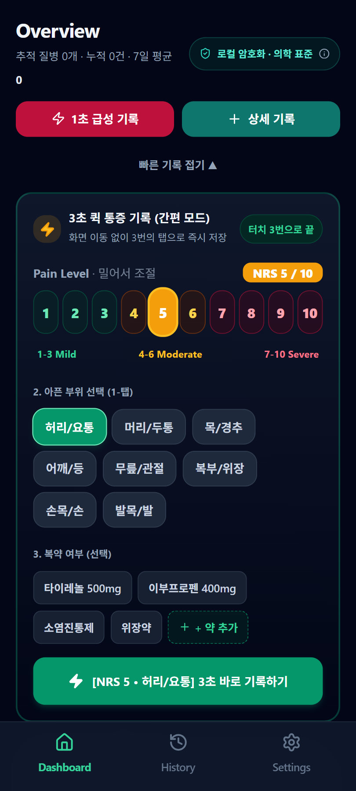
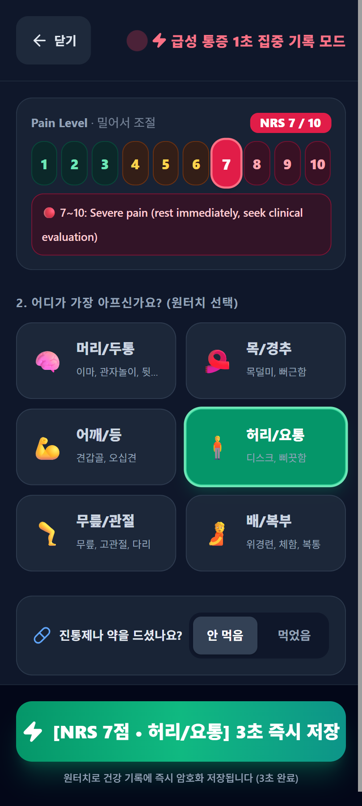
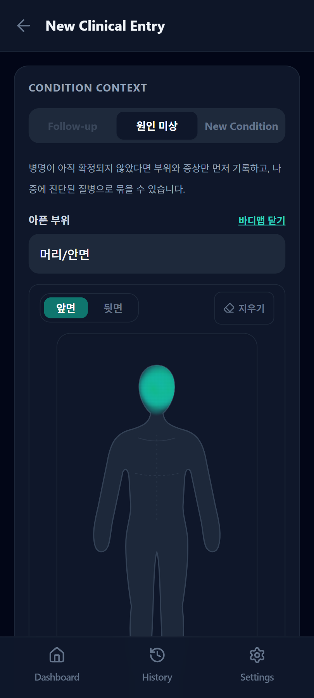
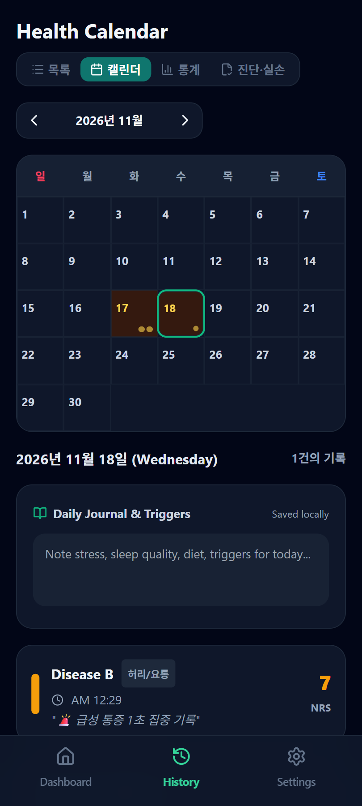
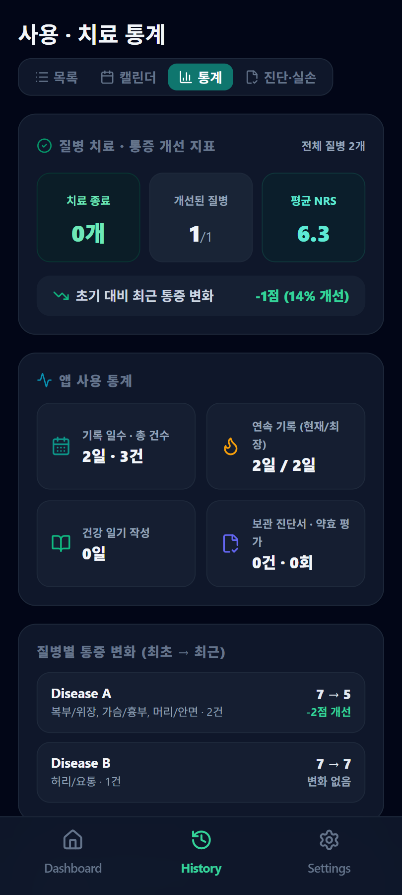
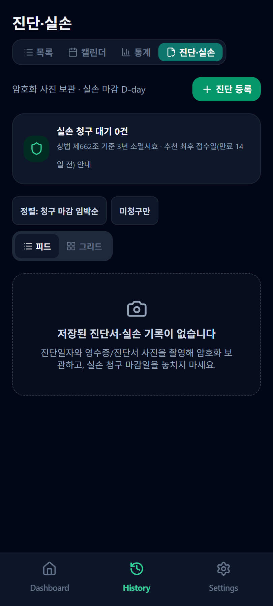
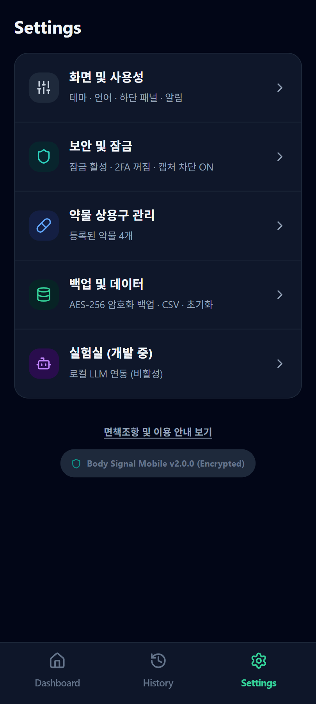

<div align="center">
  
  <h1>Body Signal (Bignal)</h1>
  <p><strong>Offline-first, hardware-hardened personal pain, symptom &amp; encrypted medical record vault for Android and the Web.</strong></p>
  <p>
    <a href="./LICENSE"></a>
    <a href="./fastlane/metadata/android/en-US/changelogs/12.txt"></a>
    <a href="#installation"></a>
    <a href="#bilingual-support"></a>
  </p>
</div>

> **100% On-Device · Zero Telemetry · Zero Cloud Dependency**
> Body Signal (`com.bodysignal.app`) keeps every pain log, body map entry, medication history, and medical image encrypted strictly inside your device. No accounts, no analytics SDKs, no ads, and no background network calls.

---

## Screenshots

<table>
  <tr>
    <td align="center" width="25%">
      <br />
      <sub><strong>Dashboard &amp; 3-Sec Quick Logger</strong></sub>
    </td>
    <td align="center" width="25%">
      <br />
      <sub><strong>1-Sec Acute Pain Mode</strong></sub>
    </td>
    <td align="center" width="25%">
      <br />
      <sub><strong>Body Map &amp; Entry</strong></sub>
    </td>
    <td align="center" width="25%">
      <br />
      <sub><strong>Calendar &amp; Journal</strong></sub>
    </td>
  </tr>
  <tr>
    <td align="center" width="25%">
      <br />
      <sub><strong>Treatment Statistics</strong></sub>
    </td>
    <td align="center" width="25%">
      <br />
      <sub><strong>Diagnostic &amp; Insurance Vault</strong></sub>
    </td>
    <td align="center" width="25%">
      <br />
      <sub><strong>Security &amp; Settings</strong></sub>
    </td>
    <td align="center" width="25%">
      
      <br />
      <sub><strong>Official Brand Emblems (3D Glass / 2D Mint)</strong></sub>
    </td>
  </tr>
</table>

---

## Why Body Signal?

Chronic and acute symptoms are hard to explain accurately during a brief doctor's appointment, yet sensitive health diaries rarely belong in third-party clouds.

**Body Signal (Bignal)** turns quick daily self-tracking into structured clinical context while treating personal health records with defense-in-depth mobile security:

- **1-Second Acute Pain Mode**: Big high-contrast SOS capture when severe pain strikes, even right from the quick widget.
- **Interactive Body Map & PQRST Tracking**: Pinpoint front/back anatomical regions and record pain quality, radiation, triggers, relieving factors, red flags, and NRS `0–10` intensity.
- **Medication & Post-Dose Relief Tracking**: Log analgesics/medications and follow-up effectiveness `1–2 hours` later.
- **30-Second Clinical Briefing (Doctor View & SOAP EMR)**: Automatically groups symptoms by medical department (Orthopedics/Rehab, Neurology, Gastroenterology, Internal Medicine), flags Red Flag warnings, and formats copyable Standard & SOAP clinical notes.
- **Encrypted Diagnostic & Insurance Vault**: Stores hospital receipts, X-ray/MRI photos, and lab results with automatic EXIF metadata stripping, AES-GCM 256 encryption, Grid/Feed views, and indemnity insurance claim deadline tracking.
- **Optional On-Device AI Briefing**: Connects strictly to loopback endpoints (`localhost`, `127.0.0.1`, `[::1]`) or built-in device edge AI (`window.ai`) — external AI servers are blocked by security policy and strict CSP.

---

## Security & Threat Model

| Security Layer | Implementation |
| :--- | :--- |
| **Mandatory Access Control** | Mandatory 6-digit PIN setup on first launch; exponential lockout backoff & constant-time hash verification |
| **Data-at-Rest Encryption** | AES-GCM 256 encryption via IndexedDB with non-extractable session key vault and SHA-256 payload integrity verification |
| **Encrypted Settings & 2FA** | User settings encrypted at rest; offline TOTP 2FA secret encrypted by PIN with replay protection and recovery codes |
| **Android KeyStore & Biometrics** | Hardware-backed `AndroidKeyStore` with atomic key rotation and OS biometric/device-credential unlock |
| **Auto-Lock & Privacy Screen** | 3-minute idle auto-lock; Android `FLAG_SECURE` screenshot/assistant blocking and instant Privacy Mask overlay |
| **Runtime Integrity Gate** | Native Android root, hook framework (`Frida` / `Xposed` / `LSPosed`), and debugger detection at launch and resume |
| **Safe Backups & Exports** | Passphrase-encrypted AES-256 JSON backups with Zod schema validation; explicit plaintext warning & CSV formula-injection neutralization |
| **Release Hardening** | Strict Content Security Policy (CSP) blocking external AI origins; Android R8 code shrinking and resource hardening |

> Disclaimer: Body Signal is a personal health logging and clinical communication aid — **not** a medical device and **not** a substitute for professional medical diagnosis or emergency care.

---

## Bilingual Support

Body Signal automatically detects your system/browser language (`English` or `한국어`) on first launch and supports instant switching at any time in **Settings → Language**, including UI labels, anatomical terms, department triage summaries, SOAP notes, and security dialogs.

---

## Installation

### Android APK (GitHub Releases & Obtainium Auto-Updates)

- **Direct Install**: Download the latest signed `BodySignal-v*-release.apk` (and verify its `.sha256` checksum) from [GitHub Releases](https://github.com/vividori55790/Body_Signal/releases).
- **Automatic Updates via [Obtainium](https://github.com/ImranR98/Obtainium)** *(Recommended until F-Droid inclusion)*:
  1. Install **Obtainium** on your Android device.
  2. Tap **Add App** and enter `https://github.com/vividori55790/Body_Signal`.
  3. Obtainium tracks new GitHub Releases and notifies/updates the APK externally — keeping Body Signal 100% offline with zero background network calls or `REQUEST_INSTALL_PACKAGES` permission.

> **Switching to F-Droid later**: GitHub Releases APKs and official F-Droid APKs use different signing keys. Before migrating between them, export an encrypted backup from **Settings → Backup & Data** first.

### F-Droid Status

F-Droid metadata and reproducible build recipes are maintained in [`body-signal/fdroid/metadata/com.bodysignal.app.yml`](./body-signal/fdroid/metadata/com.bodysignal.app.yml) and Fastlane store assets under [`fastlane/metadata/android`](./fastlane/metadata/android). Following F-Droid's Inclusion Policy, public repository history and documentation are actively maintained ahead of RFP submission.

---

## Building from Source

### Prerequisites

- **Node.js** `20+` and **npm**
- **JDK 17** and **Android SDK** (required only for Android APK builds)

### Web App & Verification Suites

All frontend application sources live under [`body-signal/`](./body-signal):

```bash
cd body-signal
npm ci
npm run lint
npx tsc --noEmit
npm run build
```

Run the automated security, storage, and E2E verification suites:

```bash
cd body-signal
node test/security_hardening_test.mjs
node scripts/test-m3-security.mjs
npm run test:data
npm run test:e2e
```

### Android APK (Capacitor + Gradle)

```bash
cd body-signal
npm ci
npm run build
npx cap sync android
cd android
./gradlew assembleDebug    # Debug APK -> app/build/outputs/apk/debug/
./gradlew assembleRelease  # Release APK (R8) -> app/build/outputs/apk/release/
```

---

## Repository Structure

```text
.
├── body-signal/                # React + TypeScript + Capacitor Android application
│   ├── android/                # Native Android shell (MainActivity, SecurityCheck, Gradle)
│   ├── fdroid/                 # F-Droid build metadata (com.bodysignal.app.yml)
│   ├── scripts/                # Security, patch & data verification runners
│   ├── src/                    # UI pages, components, crypto, clinical triage & i18n
│   └── test/                   # Security hardening & E2E suites
├── docs/images/                # README brand logos & app screenshots
├── fastlane/metadata/android/  # Store descriptions, icons & changelogs (en-US, ko-KR)
├── LICENSE                     # GNU General Public License v3.0 (GPL-3.0-only)
└── README.md
```

---

## License

Released under the [GNU General Public License v3.0 (`GPL-3.0-only`)](./LICENSE).
